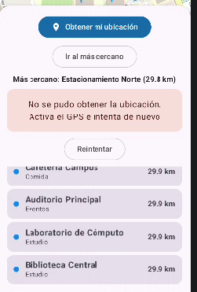

# CampusGPS

App Android que obtiene la ubicación del celular, la muestra en un mapa y dice qué lugar del campus de Tecsup (Santa Anita, Lima) está más cerca. Muestra 5 lugares con su distancia en metros, ordenados del más cercano al más lejano.

**Curso:** Programación en Móviles 13 · Localización Geográfica (docente Juan León S.)
**Autor:** Gael Matteo

## Tecnología

- Kotlin + Jetpack Compose + Material 3 (sin XML)
- Google Play Services Location (`FusedLocationProviderClient`)
- OpenStreetMap con osmdroid para el mapa (no necesita clave de API)
- Patrón MVVM + Repository

## Estructura del proyecto

```text
com.lajara.campusgps/
├── MainActivity.kt
├── model/
│   └── Modelos.kt                       Posicion, Lugar, LugarConDistancia, TipoError, UbicacionUi
├── data/
│   ├── UbicacionRepository.kt           interface
│   ├── UbicacionRepositoryGoogle.kt     implementación con FusedLocationProviderClient
│   ├── LugaresRepository.kt             interface
│   └── LugaresRepositoryLocal.kt        los 5 lugares del campus
├── util/
│   ├── Distancia.kt                     distanciaMetros
│   └── Formato.kt                       formatearDistancia
├── viewmodel/
│   ├── MapaViewModel.kt
│   └── CampusViewModelFactory.kt
└── ui/
    ├── PantallaMapa.kt
    ├── MapaUbicacion.kt
    ├── ListaLugares.kt
    ├── MensajeError.kt
    └── theme/
```

## Arquitectura MVVM

```text
View (PantallaMapa)
   | evento: pulsar el botón         ^ collectAsState()
   v                                 |
ViewModel (MapaViewModel) --- StateFlow --->
   | llama a las interfaces
   v
UbicacionRepository ---> UbicacionRepositoryGoogle (FusedLocationProviderClient)
LugaresRepository    ---> LugaresRepositoryLocal (los 5 lugares)
```

La pantalla dibuja según el estado que publica el ViewModel. El ViewModel solo conoce las interfaces de los repositorios y no recibe `Context`. Las funciones de `util/` son puras: calculan y no guardan estado.

## Lugares del campus

| Id | Nombre | Categoría |
|---:|---|---|
| 1 | Biblioteca Central | Estudio |
| 2 | Cafetería Campus | Comida |
| 3 | Laboratorio de Cómputo | Estudio |
| 4 | Auditorio Principal | Eventos |
| 5 | Estacionamiento Norte | Servicios |

## Capturas

| Permiso | Mapa con mi ubicación | Marcadores |
|---|---|---|
|  |  |  |

| Lista ordenada           | Error |
|--------------------------|---|
|   |  |
