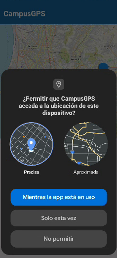
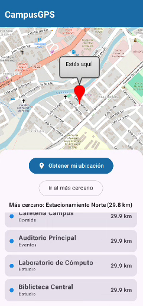
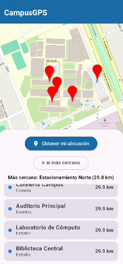
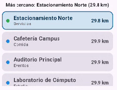
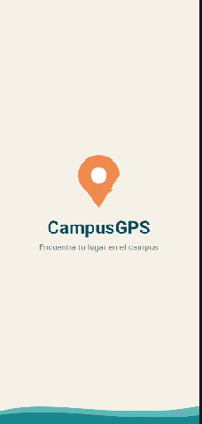
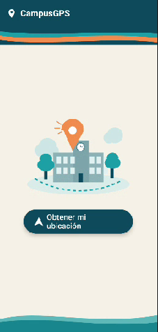
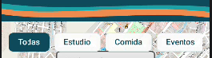
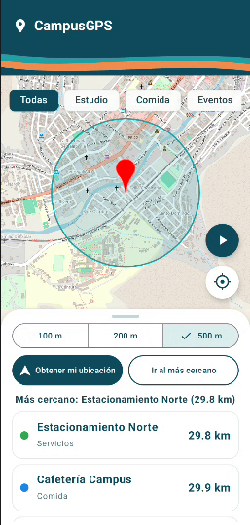
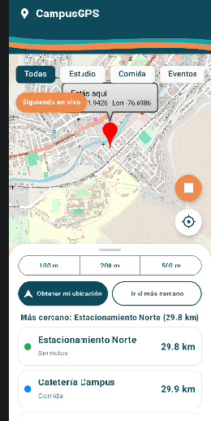

# CampusGPS

App Android que obtiene la ubicación del celular, la muestra en un mapa y dice qué lugar del campus de Tecsup (Santa Anita, Lima) está más cerca. Muestra 5 lugares con su distancia en metros, ordenados del más cercano al más lejano.

**Curso:** Programación en Móviles 13 · Localización Geográfica (docente Juan León S.)
**Autor:** Gael Matteo

## Tecnología

- Kotlin + Jetpack Compose + Material 3 (sin XML)
- Google Play Services Location (`FusedLocationProviderClient`)
- OpenStreetMap con osmdroid para el mapa (no necesita clave de API)
- Patrón MVVM + Repository

## Estructura del proyecto

```text
com.lajara.campusgps/
├── MainActivity.kt
├── model/
│   └── Modelos.kt                       Posicion, Lugar, LugarConDistancia, TipoError, UbicacionUi
├── data/
│   ├── UbicacionRepository.kt           interface
│   ├── UbicacionRepositoryGoogle.kt     implementación con FusedLocationProviderClient
│   ├── LugaresRepository.kt             interface
│   └── LugaresRepositoryLocal.kt        los 5 lugares del campus
├── util/
│   ├── Distancia.kt                     distanciaMetros
│   └── Formato.kt                       formatearDistancia
├── viewmodel/
│   ├── MapaViewModel.kt
│   └── CampusViewModelFactory.kt
└── ui/
    ├── PantallaMapa.kt
    ├── MapaUbicacion.kt
    ├── ListaLugares.kt
    ├── MensajeError.kt
    └── theme/
```

## Arquitectura MVVM

```text
View (PantallaMapa)
   | evento: pulsar el botón         ^ collectAsState()
   v                                 |
ViewModel (MapaViewModel) --- StateFlow --->
   | llama a las interfaces
   v
UbicacionRepository ---> UbicacionRepositoryGoogle (FusedLocationProviderClient)
LugaresRepository    ---> LugaresRepositoryLocal (los 5 lugares)
```

La pantalla dibuja según el estado que publica el ViewModel. El ViewModel solo conoce las interfaces de los repositorios y no recibe `Context`. Las funciones de `util/` son puras: calculan y no guardan estado.

## Lugares del campus

| Id | Nombre | Categoría |
|---:|---|---|
| 1 | Biblioteca Central | Estudio |
| 2 | Cafetería Campus | Comida |
| 3 | Laboratorio de Cómputo | Estudio |
| 4 | Auditorio Principal | Eventos |
| 5 | Estacionamiento Norte | Servicios |

## Capturas

| Permiso | Mapa con mi ubicación | Marcadores |
|---|---|---|
|  |  |  |

| Lista ordenada           | Error |
|--------------------------|---|
|   |  |

## Fase 2 · Mejoras con IA (rama `mejora-ia`)

| Mejora | Capas que cambian | Detalle |
|---|---|---|
| Filtrar por categoría | ViewModel + View | Chips (Todas, Estudio, Comida, Eventos, Servicios) que filtran mapa y lista. `lugaresVisibles` se calcula en el ViewModel. |
| Radio de cercanía | ViewModel + View | Selector de 100, 200 y 500 m. Se dibuja un círculo en el mapa y la lista marca los lugares dentro (`idsEnRadio`). |
| Seguimiento en vivo | Repository + ViewModel + View | `ubicacionEnVivo()` con `callbackFlow` y `requestLocationUpdates`. Botón Iniciar/Detener; se detiene en `ON_STOP` y la cámara acompaña la posición. |

Los prompts están en [PROMPS.md](PROMPS.md).

|           Splash           | Filtro por categoría | Radio de cercanía | Seguimiento en vivo |
|:--------------------------:|:---:|:---:|:---:|
|     |  |  |  |
| Pantalla de inicio animada | Chips que filtran mapa y lista | Círculo y etiqueta "En radio" | Etiqueta "Siguiendo en vivo" |

## Decisiones propias

- **Mapa con osmdroid (OpenStreetMap):** no necesita clave de API ni facturación. Por eso este proyecto no usa `MAPS_API_KEY` ni `local.properties` para el mapa.
- **Paquete y coordenadas:** el paquete es `com.lajara.campusgps` y los 5 lugares usan coordenadas reales del campus de Tecsup (Santa Anita). Para ver los lugares cerca en el emulador, pon la ubicación en esa zona.
- **Lugar más cercano con filtro:** `masCercano` se calcula sobre los lugares visibles, así que al filtrar por categoría el marcador verde es el más cercano dentro de esa categoría.

## Para pensar

1. **¿Por qué `FusedLocationProviderClient` está en el Repository y no en el ViewModel?**
   Porque es una dependencia de Android/Google Play Services y necesita un `Context`. El ViewModel no debe conocer `Context` ni librerías de plataforma: solo depende de la interface `UbicacionRepository`. Así es más fácil de probar (se puede reemplazar por un repositorio falso) y se puede cambiar la fuente de ubicación sin tocar el ViewModel.

2. **¿Qué diferencia hay entre el permiso de ubicación y la clave de API de Maps? ¿Qué pasa si falta cada uno?**
   El permiso lo concede el usuario y autoriza a la app a leer la ubicación del dispositivo; sin él no hay coordenadas (la app muestra el error de permiso). La clave de API identifica a la app ante el servicio de mapas de Google; sin ella el mapa sale gris o en blanco, pero la ubicación sigue funcionando. Son servicios distintos. En este proyecto el mapa usa osmdroid y no necesita clave, pero el permiso sigue siendo obligatorio.

3. **¿Por qué la clave va en `local.properties` y no en el código? ¿Qué harías si se subiera a GitHub por error?**
   `local.properties` está en `.gitignore` y no se sube, mientras que el código sí queda en el repositorio y su historial. Si se subiera por error, la borraría y crearía otra en Google Cloud (la anterior ya no es segura, aunque borre el commit), la restringiría a mi paquete y SHA-1, y corregiría el `.gitignore`.

4. **¿Dónde calculas la distancia y por qué no en el Composable?**
   En `util/Distancia.kt` (función pura) y se llama desde `MapaViewModel.actualizarDistancias`. Un Composable se recompone muchas veces, así que calcular ahí repite trabajo, mezcla lógica con UI y es difícil de probar. La pantalla solo dibuja el estado que publica el ViewModel.

5. **¿Qué pasa si el usuario niega el permiso dos veces?**
   Android deja de mostrar el cuadro de permiso y el botón ya no puede pedirlo otra vez. La app no se cierra: muestra el mensaje de error con el botón **Abrir ajustes**, que lleva a la pantalla de la app para activar el permiso manualmente.
